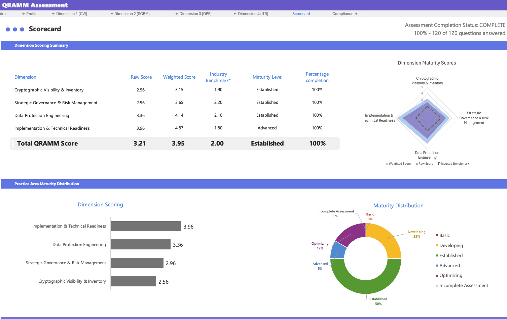
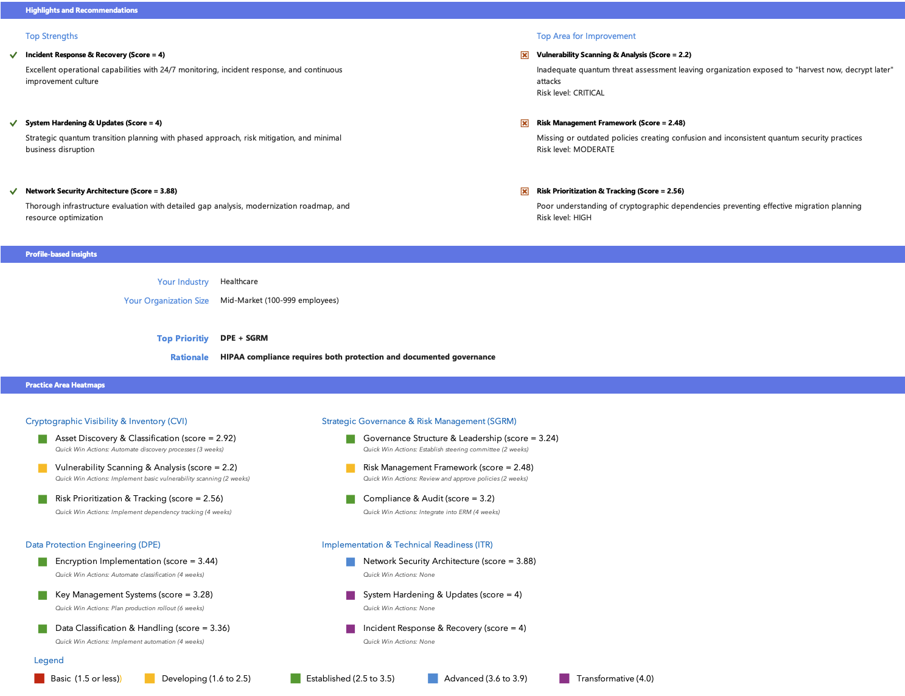
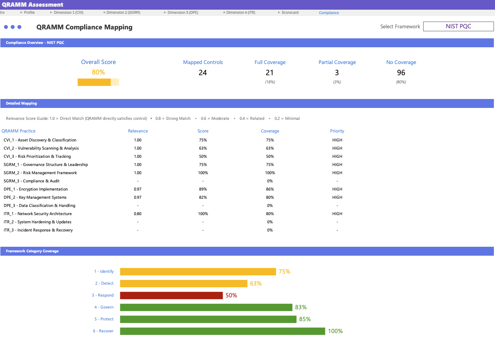
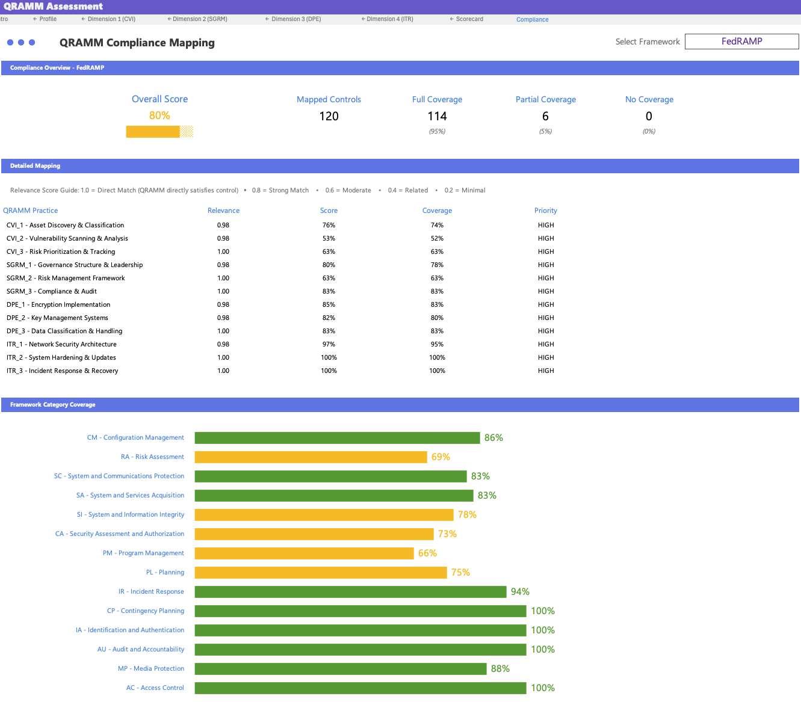
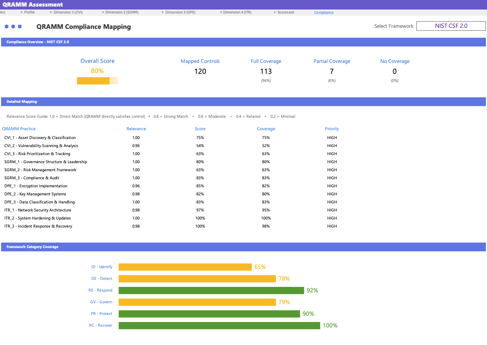

# Toolkit visual examples

Screenshots of the [QRAMM Assessment Toolkit](../toolkit/toolkit-overview.md), the Excel workbook you can [download](../toolkit/QRAMM_Assessment_Toolkit.xlsx) and fill in yourself.

## Scorecard Dashboard

  
  
<em>Scorecard showing dimension scores, weighted adjustments, and maturity visualization</em>

  
  
<em>Detailed practice-level analysis with maturity distribution and improvement recommendations</em>

## Compliance Mapping

  
  
<em>NIST Post-Quantum Cryptography framework mapping with coverage analysis</em>

  
  
<em>FedRAMP compliance mapping showing 95% coverage across security controls</em>

  
  
<em>NIST Cybersecurity Framework 2.0 mapping with practice-level and category coverage</em>

